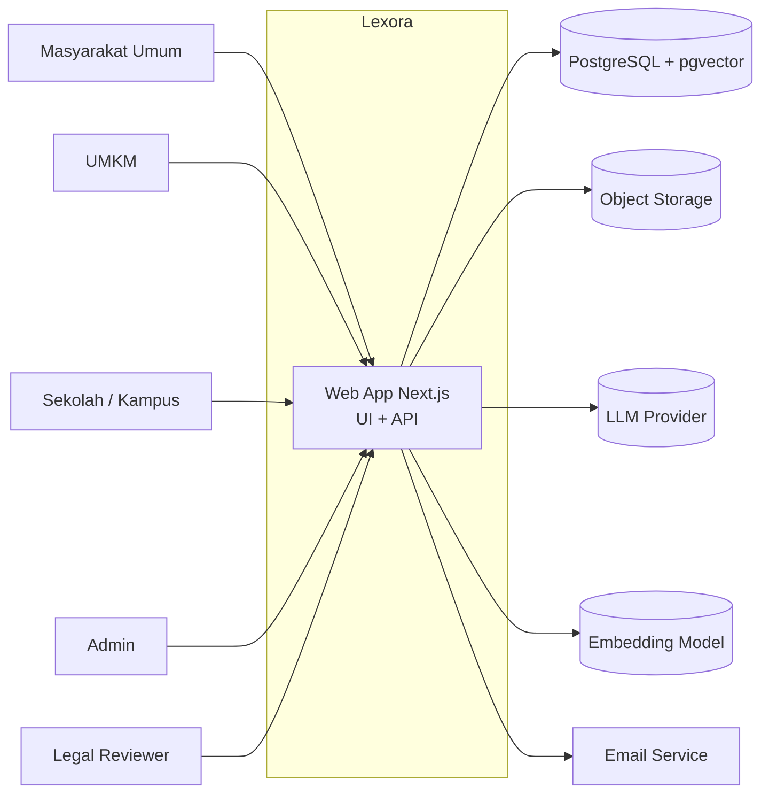
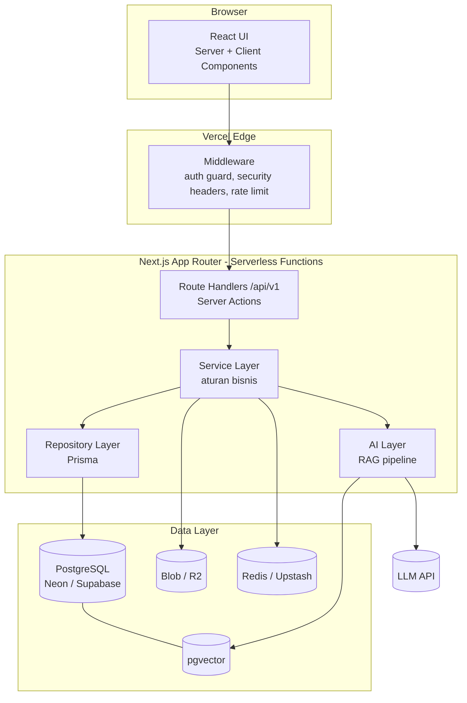
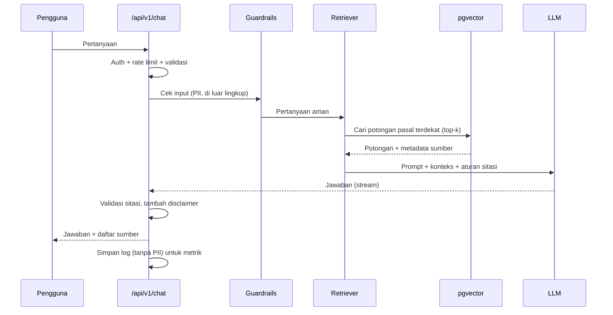
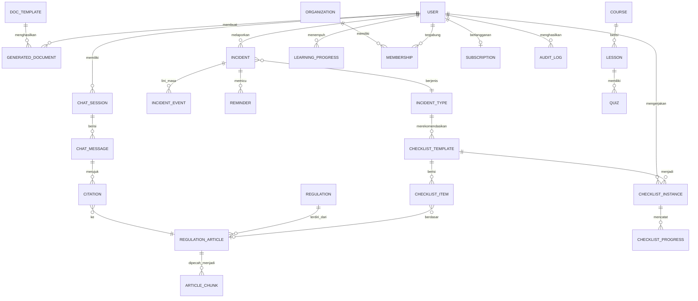
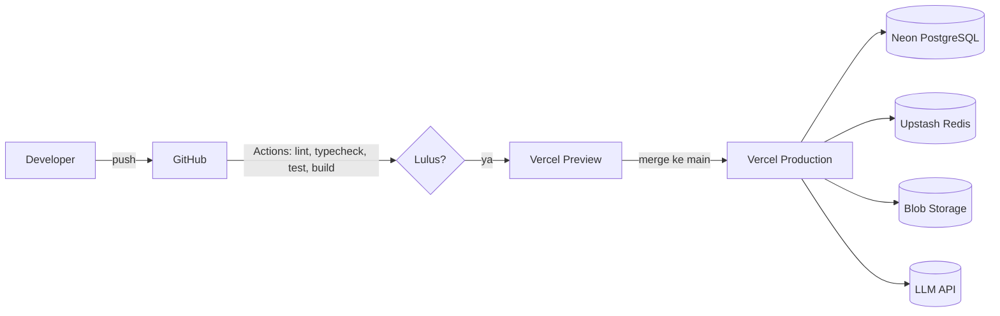

# Arsitektur Sistem Lexora

> Platform edukasi dan pendampingan hukum siber berbasis AI.
> Dokumen ini disusun untuk Web Development Competition UINIC 8.0 (bagian "Arsitektur Sistem" pada proposal).
> Sumber requirements: pitch deck "CyberLaw by AwE" dan Guidebook UINIC 8.0.

| Item | Keterangan |
|---|---|
| Nama aplikasi | **Lexora** |
| Subtema UINIC 8.0 | AI & Teknologi Digital (irisan Pendidikan) |
| Keterkaitan SDGs | SDG 16 (keadilan dan kelembagaan yang kuat), SDG 4 (pendidikan berkualitas), SDG 9 (inovasi dan infrastruktur) |
| Versi dokumen | 1.0 (draf) |

---

## 1. Ringkasan

Lexora mengubah bahasa regulasi yang rumit menjadi langkah praktis. Alur nilainya mengikuti pitch deck:

**Masalah → Penjelasan → Checklist → Template → Tindakan**

Pengguna sasaran: masyarakat umum, UMKM, serta sekolah dan kampus. Seluruh jawaban AI harus menyertakan rujukan regulasi Indonesia yang bisa ditelusuri, dan arsitektur dirancang *scalable*, *highly available*, dan aman sesuai tema lomba.

### 1.1 Masalah yang diselesaikan

- Masyarakat tidak tahu haknya saat data bocor.
- UMKM belum memahami kewajiban perlindungan data.
- Korban penipuan online tidak tahu cara melapor.
- Bahasa regulasi rumit dan informasi hukum tersebar.

### 1.2 Tujuan arsitektur

| Tujuan | Cara pencapaian |
|---|---|
| Jawaban hukum dapat dipercaya | RAG dengan sitasi wajib, review konten oleh praktisi hukum |
| Berbasis aksi, bukan sekadar informasi | Modul checklist, template dokumen, dan panduan insiden |
| Aman | Autentikasi, RBAC, validasi input, rate limiting, enkripsi data |
| Skalabel dan tersedia tinggi | Serverless auto-scale, database terkelola dengan pooling, cache |
| Interoperabel | REST API v1 terdokumentasi (OpenAPI) |
| Mudah dirawat | Arsitektur berlapis dan modular per fitur |

---

## 2. Traceability Requirements

### 2.1 Enam fitur utama (pitch deck)

| # | Fitur | Modul | Deskripsi singkat |
|---|---|---|---|
| 1 | AI Legal Assistant | `chat` | Tanya jawab hukum siber dengan RAG, jawaban bersitasi |
| 2 | Checklist Kepatuhan | `checklists` | Daftar langkah kepatuhan (UU PDP dan lainnya) dengan progres |
| 3 | Template Dokumen | `templates` | Dokumen siap pakai (misalnya kebijakan privasi, surat pemberitahuan) |
| 4 | Incident Response Guide | `incidents` | Panduan langkah demi langkah saat insiden (kebocoran data, penipuan) |
| 5 | Edukasi Interaktif | `education` | Materi, kuis, dan kemajuan belajar |
| 6 | Database Regulasi | `regulations` | Basis data peraturan dengan pencarian dan rujukan |

### 2.2 Pembeda produk (pitch deck)

| Pembeda | Implementasi di arsitektur |
|---|---|
| Bahasa manusia yang mudah dipahami | Prompt sistem AI dengan gaya bahasa awam, ringkasan pasal per regulasi |
| Berbasis aksi | Tombol "jadikan checklist" dan "buat dokumen" dari jawaban AI |
| Fokus konteks dan regulasi Indonesia | Korpus RAG hanya dari regulasi Indonesia |
| Transparansi sumber hukum | Setiap jawaban memuat sitasi ke pasal dan dokumen sumber |
| Keamanan data pengguna terjamin | Lihat bagian 8 (Keamanan) |
| Kolaborasi dengan ahli hukum | Peran `LEGAL_REVIEWER` dan alur review konten |

### 2.3 Contoh skenario kunci: toko online mengalami kebocoran data

Skenario dari pitch deck dipetakan ke enam langkah di Incident Response Guide:

| Langkah | Fungsi sistem |
|---|---|
| 1. Laporan insiden | Form pencatatan insiden (`incidents`) |
| 2. Kewajiban hukum | Pencocokan insiden ke pasal terkait lewat database regulasi |
| 3. Checklist respons | Checklist dibuat otomatis dari jenis insiden |
| 4. Template pemberitahuan | Dokumen pemberitahuan terisi otomatis dari data insiden |
| 5. Pengingat pelaporan | Penjadwalan pengingat berbasis tenggat |
| 6. Dokumentasi lengkap | Ekspor ringkasan insiden dan lini masa (PDF) |

Catatan dari pitch deck: UU PDP mewajibkan pemberitahuan tertulis paling lambat **3 × 24 jam** kepada subjek data dan lembaga. Tenggat ini disimpan sebagai **data konfigurasi** (bukan hard-coded) dan harus diverifikasi ulang oleh reviewer hukum sebelum rilis, karena regulasi dapat berubah.

---

## 3. Gambaran Arsitektur

### 3.1 Konteks sistem



### 3.2 Arsitektur logis berlapis



**Aturan alur:** `Route Handler / Server Action → Service → Repository → Database`

| Lapisan | Tanggung jawab | Tidak boleh |
|---|---|---|
| Route / Action | Terima request, validasi Zod, cek auth | Query DB, logika bisnis |
| Service | Aturan bisnis, orkestrasi | Mengenal HTTP |
| Repository | Satu-satunya akses ke Prisma | Logika bisnis |
| AI Layer | Retrieval, prompt, panggil LLM, sitasi | Menulis ke DB selain log |

---

## 4. Tech Stack

| Lapisan | Teknologi | Alasan |
|---|---|---|
| Frontend | Next.js (App Router) + TypeScript | SSR/SSG untuk SEO, satu codebase |
| UI | Tailwind CSS + shadcn/ui (Radix) | Aksesibilitas bawaan |
| Backend | Next.js Route Handlers + Server Actions | Serverless, satu deploy |
| Validasi | Zod | Skema dipakai di client dan server |
| Database | PostgreSQL (Neon atau Supabase) | Relasional, full-text search |
| Vektor | pgvector | RAG tanpa layanan tambahan |
| ORM | Prisma | Migrasi dan tipe terjamin |
| Autentikasi | Auth.js (atau Better Auth) | Sesi aman, OAuth Google |
| AI | Vercel AI SDK + LLM provider + model embedding | Streaming respons |
| Cache / rate limit | Upstash Redis | Cocok untuk serverless |
| Storage | Vercel Blob / Cloudflare R2 | Dokumen dan PDF |
| Email | Resend (atau setara) | Pengingat dan notifikasi |
| Testing | Vitest, Playwright | Unit, integrasi, E2E |
| CI/CD | GitHub Actions + Vercel | Otomatisasi lint, test, deploy |
| Hosting | Vercel (Hobby) | Sesuai syarat "hosting gratis/demosite" |

---

## 5. Struktur Proyek

```
lexora/
├── .github/workflows/ci.yml
├── docs/
│   ├── architecture.md
│   ├── erd.png
│   ├── user-flow.md
│   └── openapi.yaml
├── prisma/
│   ├── schema.prisma
│   ├── migrations/
│   └── seed.ts
├── scripts/
│   └── ingest-regulations.ts      # impor regulasi + buat embedding
├── src/
│   ├── app/
│   │   ├── (public)/              # landing, regulasi, edukasi
│   │   ├── (auth)/                # login, register
│   │   ├── (dashboard)/           # pengguna terautentikasi
│   │   │   ├── asisten/           # AI Legal Assistant
│   │   │   ├── checklist/
│   │   │   ├── dokumen/
│   │   │   ├── insiden/
│   │   │   └── admin/
│   │   └── api/
│   │       ├── health/route.ts
│   │       └── v1/
│   │           ├── chat/route.ts
│   │           ├── regulations/
│   │           ├── checklists/
│   │           ├── templates/
│   │           ├── incidents/
│   │           ├── courses/
│   │           └── search/route.ts
│   ├── modules/                   # logika bisnis per fitur
│   │   ├── chat/
│   │   ├── regulations/
│   │   ├── checklists/
│   │   ├── templates/
│   │   ├── incidents/
│   │   ├── education/
│   │   ├── users/
│   │   └── analytics/
│   ├── ai/
│   │   ├── prompts/
│   │   ├── retriever.ts
│   │   ├── citation.ts
│   │   └── guardrails.ts
│   ├── components/{ui,layout,shared}/
│   ├── lib/{db,auth,env,rate-limit,errors,api-response}.ts
│   └── middleware.ts
├── tests/{unit,integration,e2e}/
├── .env.example
├── Dockerfile
└── README.md
```

---

## 6. Desain Komponen per Modul

### 6.1 AI Legal Assistant (`chat`)

Pipeline RAG dengan sitasi wajib:



Prinsip keandalan jawaban:

- Jawaban **hanya** berdasarkan konteks hasil retrieval. Jika tidak ada konteks relevan, sistem menjawab bahwa informasi tidak ditemukan dan menyarankan ahli hukum.
- Setiap klaim hukum harus punya sitasi ke dokumen, pasal, dan versi regulasi.
- Disclaimer tetap: Lexora memberi informasi edukatif, bukan nasihat hukum resmi.
- Tombol aksi dari jawaban: "Buat checklist" dan "Buat dokumen".
- Streaming respons agar tidak terkena batas waktu serverless.

### 6.2 Database Regulasi (`regulations`)

- Hierarki data: Regulasi → Bab → Pasal → Ayat, dengan versi dan status berlaku.
- Pencarian: full-text PostgreSQL (kata kunci) dan pgvector (semantik), digabung dalam hybrid search.
- Pipeline ingest: dokumen → pemecahan per pasal → embedding → simpan → ditandai `PUBLISHED` setelah direview.

### 6.3 Checklist Kepatuhan (`checklists`)

- Template checklist (dikelola admin/reviewer) menghasilkan instans checklist per pengguna.
- Item bisa ditautkan ke pasal regulasi dan template dokumen.
- Progres dihitung per instans; metrik "checklist selesai" diambil dari sini.

### 6.4 Template Dokumen (`templates`)

- Template dengan variabel (misalnya `{{nama_usaha}}`), pengisian lewat form, hasil dapat diunduh (PDF/DOCX).
- Setiap template punya status review dan rujukan regulasi.

### 6.5 Incident Response Guide (`incidents`)

- Mesin langkah sederhana: jenis insiden → langkah respons → checklist dan template yang relevan.
- Pengingat tenggat (misalnya 3 × 24 jam) dijadwalkan lewat cron (Vercel Cron atau Upstash QStash) dan dikirim via email/notifikasi.
- Lini masa insiden disimpan sebagai audit trail dan dapat diekspor.

### 6.6 Edukasi Interaktif (`education`)

- Kursus → modul → pelajaran → kuis, dengan pelacakan progres.
- Mode institusi untuk sekolah dan kampus (kelas dan anggota).

### 6.7 Peran pengguna

| Peran | Hak akses |
|---|---|
| `GUEST` | Baca regulasi dan edukasi publik, batas tanya AI |
| `USER` | Seluruh fitur personal |
| `ORG_ADMIN` | Kelola anggota organisasi (UMKM, sekolah), lihat dashboard kepatuhan |
| `LEGAL_REVIEWER` | Review dan setujui konten hukum, sitasi, template |
| `ADMIN` | Kelola konten, pengguna, dan konfigurasi |

---

## 7. Model Data



Catatan desain data:

- `ARTICLE_CHUNK` menyimpan teks, `embedding vector`, dan penunjuk ke pasal sumber untuk sitasi.
- Konten hukum punya `status` (`DRAFT`, `IN_REVIEW`, `PUBLISHED`) dan `reviewed_by` untuk transparansi.
- `AUDIT_LOG` mencatat aksi sensitif (login, ubah konten, ekspor data).
- Data insiden dan isian dokumen dianggap sensitif: dienkripsi di tingkat kolom untuk field tertentu.

---

## 8. Keamanan

Sebagai aplikasi hukum siber, keamanan adalah nilai jual sekaligus kriteria penilaian (kualitas teknis 20%).

| Area | Kontrol |
|---|---|
| Autentikasi | Auth.js, sesi httpOnly + secure, OAuth Google, verifikasi email |
| Kata sandi | Hash dengan argon2 atau bcrypt, tanpa penyimpanan plaintext |
| Otorisasi | RBAC di service layer, cek kepemilikan resource (cegah IDOR) |
| Validasi input | Zod di semua endpoint dan form |
| Injeksi | Prisma (query terparameter), tanpa raw query dari input pengguna |
| XSS / CSRF | Escape bawaan React, CSP, SameSite cookie, token CSRF untuk mutasi |
| Header | CSP, HSTS, X-Content-Type-Options, Referrer-Policy, Permissions-Policy |
| Rate limiting | Per IP dan per pengguna, lebih ketat pada `/chat` dan `/auth` |
| Data sensitif | Enkripsi at-rest (database) dan in-transit (TLS), enkripsi kolom untuk data insiden |
| Rahasia | Environment variables, divalidasi di `lib/env.ts`, tidak pernah di-commit |
| Dependensi | Dependabot dan `npm audit` di CI |
| Privasi AI | Penyamaran PII sebelum dikirim ke LLM, log chat tanpa data pribadi, opsi hapus riwayat |
| Kepatuhan | Selaras prinsip UU PDP: minimisasi data, persetujuan, hak hapus/ekspor data |

### 8.1 Keamanan khusus AI

- **Prompt injection:** konteks hasil retrieval diperlakukan sebagai data, bukan instruksi; output divalidasi.
- **Halusinasi:** jawaban tanpa sitasi valid ditolak atau diberi peringatan.
- **Pembatasan lingkup:** guardrails menolak permintaan di luar hukum siber dan permintaan yang berpotensi menyalahgunakan (misalnya panduan melakukan kejahatan siber).

---

## 9. Skalabilitas dan High Availability

| Aspek | Strategi |
|---|---|
| Compute | Serverless Vercel, auto-scale horizontal, tidak ada *single server* |
| Database | Layanan terkelola dengan connection pooling (PgBouncer pada Neon/Supabase) |
| Cache | Redis untuk rate limit dan cache hasil pencarian regulasi |
| Konten statis | SSG/ISR dan CDN global untuk halaman regulasi dan edukasi |
| Beban AI | Streaming respons, batas token, antrean untuk tugas berat (embedding/ingest) di luar jalur request |
| Ketahanan | Timeout dan retry dengan backoff ke LLM, fallback pesan ramah saat provider gagal |
| Health check | `GET /api/health` memeriksa aplikasi dan database |
| Pemulihan | Backup otomatis database, migrasi lewat Prisma Migrate |

Catatan: batas free tier (durasi function, kuota) perlu dicek sebelum demo final. Jika kuota menjadi kendala, tugas berat dipindah ke job terjadwal.

---

## 10. Desain API (REST v1)

Konvensi: prefiks `/api/v1`, JSON, format respons seragam, dokumentasi OpenAPI di `docs/openapi.yaml` (Swagger UI).

```jsonc
// sukses
{ "data": { }, "meta": { "page": 1, "total": 42 } }
// gagal
{ "error": { "code": "VALIDATION_ERROR", "message": "...", "details": [ ] } }
```

| Metode | Endpoint | Fungsi | Auth |
|---|---|---|---|
| POST | `/chat` | Tanya AI (streaming) + sitasi | Opsional (terbatas) |
| GET | `/regulations` | Daftar dan cari regulasi | Publik |
| GET | `/regulations/{id}` | Detail regulasi dan pasal | Publik |
| GET | `/search?q=` | Hybrid search | Publik |
| GET | `/checklists/templates` | Daftar template checklist | User |
| POST | `/checklists` | Buat instans checklist | User |
| PATCH | `/checklists/{id}/items/{itemId}` | Tandai item selesai | User |
| GET | `/templates` | Daftar template dokumen | User |
| POST | `/templates/{id}/generate` | Hasilkan dokumen | User |
| POST | `/incidents` | Catat insiden baru | User |
| GET | `/incidents/{id}` | Detail, langkah, dan lini masa | User |
| POST | `/incidents/{id}/reminders` | Atur pengingat | User |
| GET | `/courses` | Daftar kursus | Publik |
| POST | `/courses/{id}/progress` | Catat progres belajar | User |
| GET | `/analytics/summary` | Ringkasan metrik | Admin |
| GET | `/health` | Status layanan | Publik |

Dengan API publik yang terdokumentasi, Lexora memenuhi unsur interoperabilitas pada tema lomba dan menjadi dasar fase "API untuk platform lain" di roadmap.

---

## 11. Deployment



| Environment | Tujuan | Database |
|---|---|---|
| Local | Pengembangan | Docker Postgres atau Neon branch |
| Preview | Setiap pull request | Neon branch |
| Production | Demo lomba | Neon utama |

Variabel lingkungan (contoh, lihat `.env.example`):

```
DATABASE_URL=            # pooled connection
DIRECT_URL=              # untuk migrasi
AUTH_SECRET=
AUTH_GOOGLE_ID=
AUTH_GOOGLE_SECRET=
LLM_API_KEY=
EMBEDDING_API_KEY=
UPSTASH_REDIS_REST_URL=
UPSTASH_REDIS_REST_TOKEN=
BLOB_READ_WRITE_TOKEN=
RESEND_API_KEY=
```

---

## 12. Pengujian dan Kualitas

| Jenis | Alat | Cakupan |
|---|---|---|
| Unit | Vitest | Service, util, validasi Zod |
| Integrasi | Vitest + DB uji | Route handler dan repository |
| E2E | Playwright | Alur: tanya AI, checklist, insiden, template |
| Aksesibilitas | Lighthouse, axe | Skor dicantumkan di proposal |
| Keamanan | `npm audit`, tinjauan header | Pemeriksaan dasar OWASP |
| Evaluasi AI | Kumpulan pertanyaan uji + rubrik | Akurasi, ketepatan sitasi, tingkat penolakan |
| Usability | Uji dengan 5 sampai 10 responden | Bahan bab "Hasil Pengujian Pengguna" (SUS dan waktu tugas) |

---

## 13. Pemantauan dan Metrik Keberhasilan

Dashboard admin memantau metrik dari pitch deck:

| Metrik | Sumber data |
|---|---|
| Pengguna aktif | Sesi dan event login |
| Pertanyaan terjawab oleh AI | `CHAT_MESSAGE` |
| Checklist kepatuhan selesai | `CHECKLIST_INSTANCE` |
| Template dokumen digunakan | `GENERATED_DOCUMENT` |
| Kepuasan pengguna | Rating pada jawaban dan survei singkat |
| Konversi ke premium | `SUBSCRIPTION` |
| Mitra institusi terdaftar | `ORGANIZATION` |

Observabilitas teknis: log terstruktur, Vercel Analytics dan log, pelacakan galat (misalnya Sentry), serta pemantauan uptime pada `/api/health`.

---

## 14. Risiko dan Mitigasi

| Risiko | Dampak | Mitigasi di arsitektur |
|---|---|---|
| Akurasi AI | Kesalahan informasi hukum | RAG dengan sitasi wajib, guardrails, evaluasi berkala, disclaimer |
| Perubahan regulasi | Layanan tidak sesuai | Versi dan status regulasi, pipeline ingest ulang, tenggat sebagai konfigurasi |
| Keamanan aplikasi | Kebocoran data pengguna | Kontrol pada bagian 8, audit log, audit keamanan berkala |
| Kepercayaan pengguna | Penurunan pengguna aktif | Transparansi sumber, review ahli hukum, edukasi berkala |
| Persaingan | Kehilangan pangsa pasar | Diferensiasi: berbasis aksi dan fokus regulasi Indonesia |
| Ketergantungan provider AI | Gangguan layanan | Lapisan abstraksi LLM, fallback pesan, batas biaya |

---

## 15. Pemetaan Roadmap ke Arsitektur

| Fase | Cakupan produk | Dampak arsitektur |
|---|---|---|
| 1. MVP | Chatbot edukasi, FAQ hukum siber, checklist dasar, template kebijakan privasi | Modul `chat`, `regulations`, `checklists`, `templates` (cakupan versi lomba) |
| 2. Validasi | Uji 50 sampai 100 pengguna, wawancara UMKM | Analytics dan form umpan balik |
| 3. Kredibilitas | Kolaborasi praktisi hukum, sitasi, review konten | Peran `LEGAL_REVIEWER`, status konten, sitasi |
| 4. B2B | Dashboard kepatuhan untuk UMKM, sekolah, perusahaan kecil | `ORGANIZATION`, `MEMBERSHIP`, dashboard organisasi |
| 5. Skala | AI lanjutan, multi-bahasa, API untuk platform lain, ekspansi regional | API v1 publik berkunci, i18n, abstraksi LLM |

### 15.1 Model bisnis dan dampak teknis

Paket: Free, Premium Personal, Paket UMKM, Lisensi Institusi, Layanan Ahli, dan Pelatihan/Workshop. Secara teknis dibatasi lewat `SUBSCRIPTION` dan *feature flag* per paket (kuota tanya AI, jumlah dokumen, akses organisasi). Pembayaran bukan bagian cakupan lomba.

---

## 16. Cakupan Versi Lomba (Prioritas)

Karena tenggat proposal dan repository adalah **30 Oktober 2026**, prioritas implementasi:

| Prioritas | Item |
|---|---|
| Wajib | AI Legal Assistant dengan sitasi, database regulasi (korpus kecil tapi terkurasi), checklist kepatuhan, template dokumen, auth + RBAC, `/api/health`, README, OpenAPI |
| Sebaiknya | Incident Response Guide untuk satu skenario (kebocoran data), edukasi interaktif ringan, dashboard metrik sederhana |
| Ditunda | Pembayaran, multi-bahasa, API berkunci publik, lisensi institusi penuh |

---

## 17. Asumsi dan Hal yang Perlu Dikonfirmasi

1. Pitch deck belum merinci stack teknis, sehingga stack pada dokumen ini adalah usulan.
2. Nama produk pada pitch deck adalah "CyberLaw"; dokumen ini memakai **Lexora** sesuai permintaan. Samakan nama di seluruh proposal dan UI.
3. Tenggat 3 × 24 jam dan isi pasal UU PDP dikutip dari pitch deck dan harus diverifikasi ke teks resmi peraturan sebelum dipublikasikan.
4. Pilihan LLM provider dan model embedding belum ditetapkan; arsitektur memakai lapisan abstraksi agar mudah diganti.
5. Sumber korpus regulasi harus resmi dan berlisensi jelas (misalnya situs peraturan pemerintah) beserta pencatatan sumbernya.
6. Tema lomba pada Bab I dan Bab II guidebook berbeda; rujuk tema Bab II di proposal dan konfirmasi ke panitia.